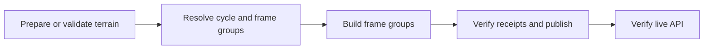

# Forecast builder

Builds v5 forecast manifests, map tiles, point samples, and atmospheric profiles.

```sh
pnpm forecast --model gfs --out output --cache-dir .cache/gfs \
  --terrain-catalog-ref output/terrain-catalog-ref.json --terrain-store-dir .cache/terrain
```

The command prints the manifest path under `output/builds/gfs/`. Set `--cycle`
to select a UTC run. Without a local terrain store the builder reads terrain
from R2. [Local setup and preview](../../docs/development.md#build-a-real-forecast).

## Check inputs and capacity

```sh
pnpm capacity --model icon-eu
pnpm input:proof --model icon-eu --cache-dir .cache/icon-eu
```

The [capacity report](src/capacity.ts) estimates memory, raster work, and
retained bytes before downloading weather. Use `--cadence-hours` to model a
different publishing interval. `performance.json` records observed grid sizes
and resource use. [CLI reference](../../docs/reference.md#batch-cli).

## Parallel builds

The [forecast workflow](../../.github/workflows/forecast.yml) prepares cached
terrain, freezes the cycle and input hashes, and dispatches one job per frame
group. Workers upload immutable archives and sample shards. Assembly verifies
the complete set of receipts before updating the latest pointer.



The workflow retains the plan, coverage, and receipts. Use
[operations](../../docs/operations.md) to resume, roll back, or clean up a build.

## Ownership

- [Providers](src/providers.ts) select and normalize weather inputs.
- [Whole-domain frames](src/whole-domain/frames.ts) derive, pack, and render layers.
- [Parallel builds](src/parallel.ts) plan and assemble shards. [Build receipts](src/build-receipts.ts) verify uploads.
- [Publication](src/publication.ts) validates objects and commits the latest pointer.
- [Terrain evaluation](src/refinement/README.md) replays archived regional controls.

## Tests

```sh
pnpm test apps/batch
pnpm test:integration apps/batch
```
