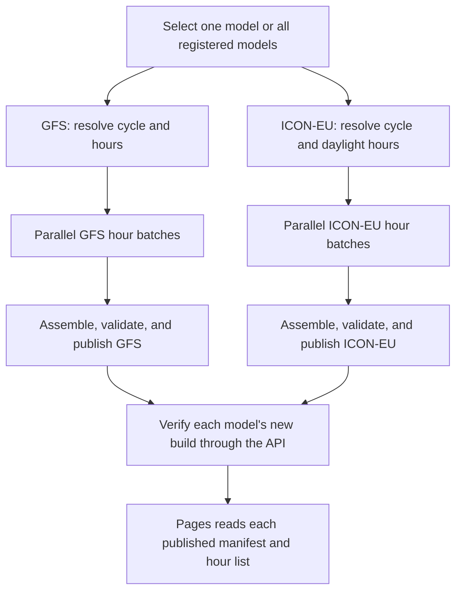

# Forecast builder

Downloads GFS or ICON-EU weather data and builds map tiles, point sample packs,
and a build manifest.

Run from the repository root:

```sh
pnpm forecast --model gfs --out output --cache-dir .cache/gfs
```

Writes the completed build under `output/builds/gfs/` and prints the manifest
path. Pass `--model icon-eu` for regional ICON-EU lift and `--cycle` to select a
specific UTC run. See [development](../../docs/development.md#build-a-real-forecast)
to preview the build locally.

Add `--terrain-catalog-ref PATH` to enable configured refinement zones. Use
`--terrain-store-dir PATH` for a local terrain store; otherwise the catalog and
terrain come from R2. See [terrain setup](../../docs/development.md#terrain-refinement).

Estimate build resources including configured refinement grids, or verify a
single upstream frame:

```sh
pnpm capacity --model icon-eu
pnpm input:proof --model icon-eu --cache-dir .cache/icon-eu
```

See the [CLI reference](../../docs/reference.md#batch-cli) for all options and
[operations](../../docs/operations.md) for publication, rollback, and cleanup.
Run batch tests with `pnpm test apps/batch`.

## Source layout

- [src/cli.ts](src/cli.ts) & [src/commands.ts](src/commands.ts): CLI entry point and flag definitions.
- [src/build.ts](src/build.ts): sequential build orchestration and manifest assembly.
- [src/frame-build.ts](src/frame-build.ts): frame acquisition, derivation, packing, and tile rendering.
- [src/parallel.ts](src/parallel.ts): build-plan creation, shard execution, and shard assembly.
- [src/provider.ts](src/provider.ts) & [src/providers.ts](src/providers.ts): provider interface and model registry lookup.
- [src/gfs](src/gfs/README.md): NOAA GFS adapter.
- [src/icon](src/icon/README.md): DWD ICON-EU adapter.
- [src/render.ts](src/render.ts): WebP map tile rendering and PMTiles packaging.
- [src/terrain](src/terrain/README.md): Copernicus GLO-90 DEM import, window reader, and grid preparation.
- [src/refinement](src/refinement/README.md): polygon grids, prepared terrain, and frozen shard inputs.
- [pmtiles.json](pmtiles.json): pinned `pmtiles` binary version and SHA-256 digests.

## Parallel builds

The [forecast workflow](../../.github/workflows/forecast.yml) accepts `all`,
`gfs`, or `icon-eu` and calls the reusable
[model workflow](../../.github/workflows/forecast-model.yml) per model. Each
model resolves its cycle and daylight-filtered hours, prepares configured grids,
and freezes their masks and terrain arrays in the plan artifact. Up to four
`forecast-shard` workers load these inputs locally. Each acquired native frame
supplies the base fields and every refinement patch. Assembly merges each grid's
sample packs and validates the complete build before publication to R2.



Concurrency locks are scoped per environment and model (`forecast-<env>-<model>`),
and artifacts are namespaced by model, run ID, and run attempt. See
[capacity.ts](src/capacity.ts) and [parallel.ts](src/parallel.ts) for resource
limits.
