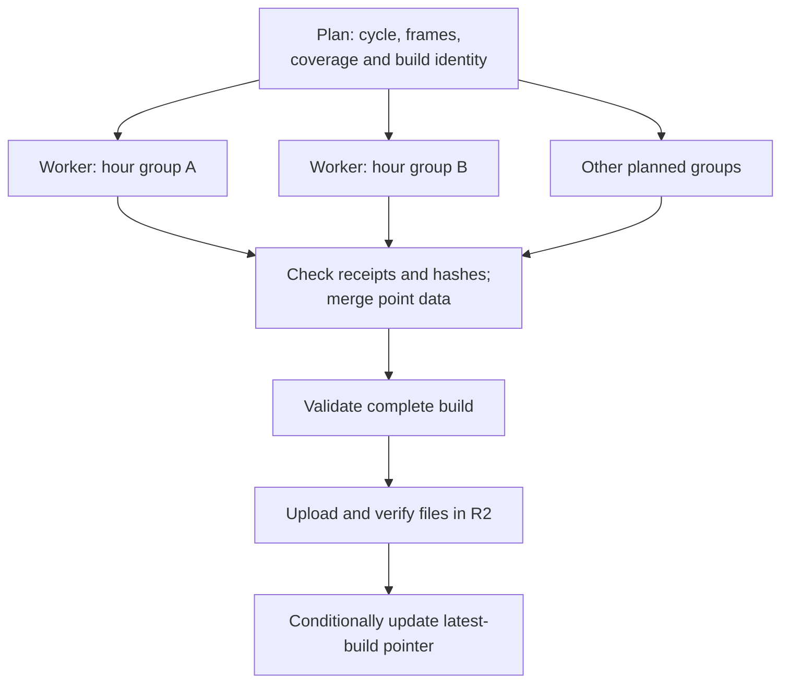

# Forecast builder

Downloads GFS or ICON-EU weather data and writes map tiles, point forecasts,
and a manifest describing the build.

After the [root setup](../../README.md), run from the repository root:

```sh
pnpm forecast --model gfs --out output --cache-dir .cache/gfs
```

This downloads a recent forecast, reuses cached files, and prints the completed
manifest path under `output/builds/gfs/`. Use `--model icon-eu` for regional
ICON-EU lift, and `--cycle` with a UTC initialization time to select a particular
run. See [development](../../docs/development.md#build-a-real-forecast) to open
the result locally.

To estimate resource use or check source downloads before a full build:

```sh
pnpm capacity --model icon-eu
pnpm input:proof --model icon-eu --cache-dir .cache/icon-eu
```

`capacity` prints resource estimates without downloading weather data.
`input:proof` downloads and checks one input frame, then prints a JSON report.
The [CLI reference](../../docs/reference.md#batch-cli) lists all options and the
local validation command. [Operations](../../docs/operations.md) covers
publication, rollback, and cleanup.

Run `pnpm test apps/batch` for the batch tests. `pnpm build` bundles the apps;
use `pnpm forecast` to generate forecast data.

## Source layout

- [src/cli.ts](src/cli.ts): command entry point.
- [src/commands.ts](src/commands.ts): command names and options.
- [src/build.ts](src/build.ts): the forecast build steps.
- [src/frame-build.ts](src/frame-build.ts): the shared acquisition, calculation,
  packing and rendering path for a group of hours.
- [src/parallel.ts](src/parallel.ts): frozen plans, independent workers and complete
  build assembly; the hosted workflow runs the workers on separate runners.
- [src/provider.ts](src/provider.ts): shared provider and acquisition-session types.
- [src/providers.ts](src/providers.ts): model-to-provider registration.
- [src/gfs](src/gfs/README.md): GFS provider, downloads, decoding, and tests.
- [src/icon](src/icon/README.md): ICON-EU provider, downloads, geometry, decoding,
  and tests.
- [src/render.ts](src/render.ts): map tile generation.
- [pmtiles.json](pmtiles.json): PMTiles tool version and download checksums.

The adapters return [normalized arrays](../../packages/forecast/src/inputs.ts)
for the [forecast calculations](../../packages/forecast/README.md).
[Science](../../docs/science.md) explains the calculations and source handling;
[extensions](../../docs/extensions.md#add-a-weather-model) covers adding a source.

## Parallel builds

The hosted [forecast workflow](../../.github/workflows/forecast.yml) resolves one
cycle and writes a plan before starting workers. Each worker processes a group
of hours using the same acquisition, calculation, packing, and rendering code
as a sequential build.



Hours run sequentially within each worker; the planned groups run in parallel.
Every worker opens and closes its own provider session, including any earlier
source fields needed for interval calculations. Finalization rejects missing,
extra, or mismatched groups. The [capacity checks](src/capacity.ts) and
[parallel planner](src/parallel.ts) bound the work; [operations](../../docs/operations.md)
covers publication and recovery.
