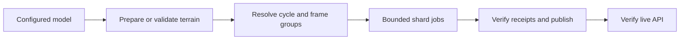

# Forecast builder

Downloads configured weather sources and builds map tiles, point sample packs,
and a build manifest.

Run from the repository root:

```sh
pnpm forecast --model gfs --out output --cache-dir .cache/gfs \
  --terrain-catalog-ref output/terrain-catalog-ref.json --terrain-store-dir .cache/terrain
```

Writes the completed build under `output/builds/gfs/` and prints the manifest
path. `--model` selects a [configured source](../../packages/contracts/config/models.json)
and `--cycle` selects a UTC run. See [development](../../docs/development.md#build-a-real-forecast)
to preview the build locally.

Configured builds require `--terrain-catalog-ref PATH` for
whole-domain lift surfaces. Use `--terrain-store-dir PATH` for a local terrain
store; otherwise terrain comes from R2. Precipitation retains its native
surface. See [terrain setup](../../docs/development.md#terrain-refinement).

Estimate build resources from the bundled sparse coverage, or verify a single
upstream frame:

```sh
pnpm capacity --model icon-eu
pnpm input:proof --model icon-eu --cache-dir .cache/icon-eu
```

See the [CLI reference](../../docs/reference.md#batch-cli) for all options and
[operations](../../docs/operations.md) for publication, rollback, and cleanup.
Run `pnpm test apps/batch` for unit tests and `pnpm test:integration apps/batch`
for complete builds and PMTiles checks.

The capacity report projects retention from configured UTC starts. Use
`--cadence-hours` to model a different publishing interval.
`performance.json` reports native and fine grid sizes separately.
[Whole-domain admission](src/whole-domain/capacity.ts) bounds fine work by
packed cell storage, raster work, and memory.

The [tile budget](src/capacity.ts) bounds raster work across layers, frames and
surfaces. Each additional zoom level adds about four times the previous level's
tiles. [Forecast settings](../../packages/contracts/config/models.json) select
the rendered subset of each immutable coverage pyramid;
elapsed time and memory have separate admission limits.

## Source layout

- [src/cli.ts](src/cli.ts) & [src/commands.ts](src/commands.ts): CLI entry point and flag definitions.
- [src/build.ts](src/build.ts): sequential build orchestration and manifest assembly.
- [src/whole-domain/frames.ts](src/whole-domain/frames.ts): acquire, derive, pack, and render frames.
- [src/parallel.ts](src/parallel.ts): build-plan creation, shard execution, and shard assembly.
- [src/build-receipts.ts](src/build-receipts.ts): match a publication to admitted shard receipts and verify remote objects.
- [src/provider.ts](src/provider.ts) & [src/providers.ts](src/providers.ts): provider interface and model registry lookup.
- [src/indexed-grib](src/indexed-grib/README.md): indexed GRIB2 range acquisition and isobaric normalization.
- [src/split-grib](src/split-grib/README.md): split GRIB2 acquisition and model-level normalization.
- [src/render.ts](src/render.ts): WebP map tile rendering and PMTiles packaging.
- [Publication](src/publication.ts) uploads immutable files and updates latest pointers.
  [Artifact lists](src/publication-objects.ts) read object keys, digests, lengths,
  and media types from manifests and provenance indexes.
- [src/terrain](src/terrain/README.md): Copernicus GLO-90 DEM import, window reader, and grid preparation.
- [src/whole-domain](src/whole-domain/prepare.ts): sparse coverage, packed terrain columns, bounded sample shards and frozen whole-domain inputs.
- [src/refinement](src/refinement/README.md): regional polygon grids and legacy refinement evaluation.
- [pmtiles.json](pmtiles.json): pinned `pmtiles` binary version and SHA-256 digests.

## Parallel builds

The [forecast workflow](../../.github/workflows/forecast.yml) accepts a configured
model ID or `all` and calls the reusable
[model workflow](../../.github/workflows/forecast-model.yml) per model.
`forecast-terrain` prepares or validates each model's reusable terrain cache in
R2. Planning then resolves the cycle and selected forecast hours, loads cached
terrain, and freezes coverage, terrain and recipe identities in the plan. The
[planner](src/parallel.ts) partitions the selected hours into bounded groups.
`forecast-shard` workers stage verified terrain from R2 and upload validated
archives and frame-group sample shards directly. Each acquired native frame
supplies its native layers and packed fine lift fields. Assembly verifies the
complete receipt partition before publication. Workflow artifacts retain the
plan, coverage and receipts; full payload retention is opt-in.
Local forecast builds prepare terrain on first use and reuse it thereafter.



Concurrency locks are scoped per environment and model (`forecast-<env>-<model>`),
and artifacts are namespaced by model, run ID, and run attempt. See
[capacity.ts](src/capacity.ts) and [parallel.ts](src/parallel.ts) for resource
limits.
