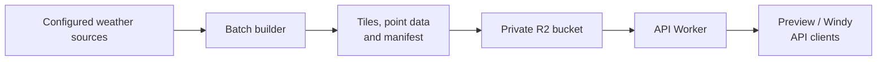
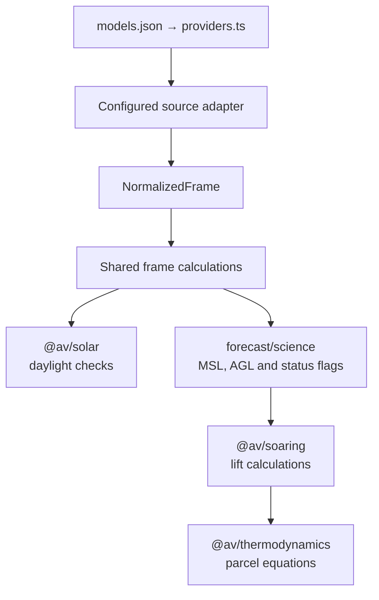
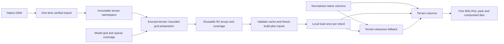

# Architecture

The batch app downloads weather data and builds forecast files. A Cloudflare
Worker serves those files from a private R2 bucket to the standalone map, Windy
plugin, and API clients.

Models share the build and serving pipeline. The scheduled workflow runs each
model on its configured schedule; manual runs can target one model. Whole-domain lift
surfaces share each model's cycle, timeline, publication and URLs. See
[deployments](status.md) for live apps and workflow runs.

## Workspace map

- [apps/batch](../apps/batch/README.md): source downloads, forecast builds,
  validation, uploads, and cleanup.
- [apps/api](../apps/api/README.md): HTTP routes, R2 reads, and caching.
- [apps/preview](../apps/preview/README.md): standalone MapLibre map.
- [apps/windy-plugin](../apps/windy-plugin/README.md): Windy map and time controls.
- [packages/contracts](../packages/contracts/README.md): shared types, model and
  layer definitions, grids, palettes, and client helpers.
- [packages/forecast](../packages/forecast/README.md): whole-frame calculations,
  grid sampling, and the numeric file format.
- [packages/solar](../packages/solar/README.md): solar position, sunrise/sunset,
  and grid daylight checks.
- [packages/thermodynamics](../packages/thermodynamics/README.md): dry-air
  thermodynamics and parcel equations.
- [packages/soaring](../packages/soaring/README.md): convective depth, thermal
  velocity, and usable lift calculations.
- [packages/windgram](../packages/windgram/README.md): standalone SVG windgram
  scene builder, renderer, inspector, and `/profile` adapter.

## Configuration and calculations

[models.json](../packages/contracts/config/models.json) owns model identities,
source fields and URLs, grids, coverage, capabilities, timing and execution.
[forecast-windows.ts](../packages/contracts/src/forecast-windows.ts) owns output
windows and derives selected hours, map end, minimum horizon and shard counts.
[products.ts](../packages/contracts/src/products.ts) validates the registry;
the Python mask generator reads the same file. `pnpm docs:generate` projects
the configured cron union into the forecast workflow. The
[indexed GRIB](../apps/batch/src/indexed-grib/README.md) and
[split GRIB](../apps/batch/src/split-grib/README.md) adapters bind each model's
source profile to its format-specific acquisition and decoding. The shared
[provider types](../apps/batch/src/provider.ts) define cycle discovery, input
proof, and acquisition sessions; [providers.ts](../apps/batch/src/providers.ts)
selects the configured source protocol.

Adapters return [normalized arrays](../packages/forecast/src/inputs.ts) with
units, missing-data masks, and time intervals, with a shared isobaric axis or
per-column pressures on model levels.
[frame.ts](../packages/forecast/src/frame.ts) checks daylight and runs the column
solver, deriving both lift layers from a single column evaluation.
[Method descriptors](../packages/contracts/src/methods.ts) record the inputs and
parameters in each build manifest. See [science](science.md) for the equations.

## Build and storage

[build.ts](../apps/batch/src/build.ts) runs a sequential build.
[parallel.ts](../apps/batch/src/parallel.ts) splits the frame pipeline across
workers for the hosted workflow. The [caller](../.github/workflows/forecast.yml)
selects models from the registry and invokes the reusable
[model workflow](../.github/workflows/forecast-model.yml). Each model resolves
its cycle and frame list before starting workers, then verifies their immutable
uploads and receipt partition before publication. See the
[batch guide](../apps/batch/README.md#parallel-builds) for the worker flow and
[capacity checks](../apps/batch/src/capacity.ts) for build budgets.

Each layer and frame writes one composited PMTiles archive. Version-5 manifests
assign each layer to a native or fine surface with sparse coverage and bounded
sample shards. Point queries read bounded ranges per selected surface and frame
group. Tiles and point queries share packed fields and interpolation logic.
Legacy version-3/version-4 readers retain their numeric pack formats.

The build manifest lists files, SHA-256 digests, frames, layers, methods,
provenance, and expiry. Coverage bitsets mark public output cells and halo cells
used for edge interpolation; see [the data guide](data.md).

Publication and rollback verify every grid's coverage and numeric pack plus the
composited tile archives before changing the model's latest-build pointer with a
compare-and-swap write. Workflow concurrency locks
are scoped per environment and model. After pointer commit, the publisher checks
that the live API serves the new build. See [operations](operations.md) for
publication, retention, and rollback.

## Terrain preparation

[Terrain inputs](../apps/batch/src/terrain/README.md) are managed separately
from weather runs. The importer verifies and repacks Copernicus GLO-90 COGs into
an immutable global catalog in R2, and the reader prepares elevation arrays on a
target grid.

The model configuration selects native-grid subdivision factors.
The hosted `forecast-terrain` job prepares or validates reusable packed DEMs
before forecast planning. [Whole-domain preparation](../apps/batch/src/whole-domain/prepare.ts)
loads the cache, freezes sparse coverage and packed DEM identities in the build
plan, and stages their files for workers. Local builds prepare missing terrain
on demand. Precipitation retains its native surface. The
[polygon configuration](../packages/contracts/config/refinement.json) supports
regional evaluation grids.

[`@av/forecast/refinement`](../packages/forecast/src/refinement.ts) derives
terrain-referenced MSL and AGL by reconstructing native columns over prepared
DEMs. Same-frame terrain clearance supplies unsupported-valley fallback.
[Method descriptors](../packages/contracts/src/methods.ts) bind each model's
pressure coordinate and shared parameters; [science](science.md#terrain-columns)
owns the equations. [Build admission](../apps/batch/src/capacity.ts) includes
every pack, terrain array, mapping and raster input.

## Serving and clients

The API serves published, unexpired builds from R2, caching metadata and PMTiles
directories and coalescing identical reads within the
[serving budgets](serving-budgets.md). [wrangler.json](../apps/api/wrangler.json)
configures the Worker and R2 bindings.

Clients pin a build ID for tiles and point requests and read available layers,
frames, units, and palettes from the build's manifest descriptors. Shared client
helpers live in [`@av/contracts/client`](../packages/contracts/src/client.ts).
[Local development](development.md) seeds a synthetic build into a local Worker.
See [extensions](extensions.md) to add a model, layer, or grid.
