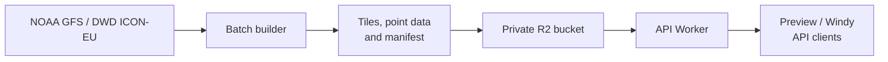
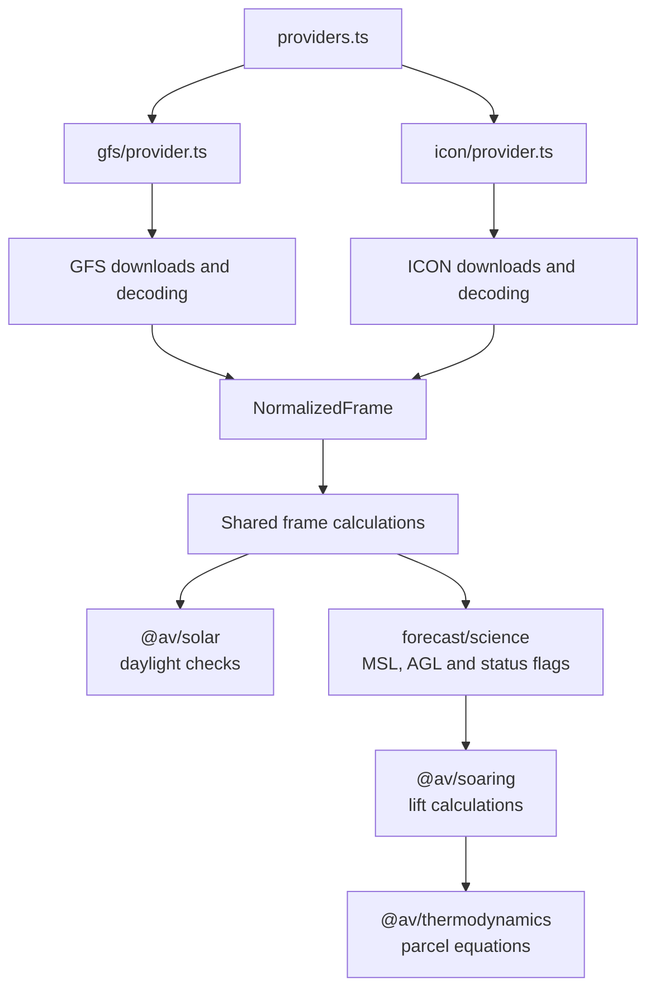
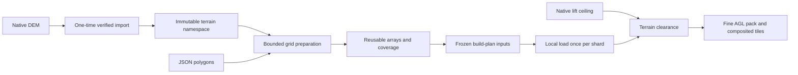

# Architecture

The batch app downloads weather data and builds forecast files. A Cloudflare
Worker serves those files from a private R2 bucket to the standalone map, Windy
plugin, and other API clients. Forecast calculations happen during the build;
serving a map or sampling a point does not download weather data.

GFS and ICON-EU use the same build and serving code. The scheduled workflow
selects all registered models; a manual run can select one model. Internal
refinement patches share that model's cycle, timeline, publication and URLs.

## Workspace map

- [apps/batch](../apps/batch/README.md): source downloads, forecast builds,
  validation, uploads, and cleanup.
- [apps/api](../apps/api/README.md): HTTP routes, R2 reads, and caching.
- [apps/preview](../apps/preview/README.md): standalone MapLibre map.
- [apps/windy-plugin](../apps/windy-plugin/README.md): Windy map and time controls.
- [packages/contracts](../packages/contracts/README.md): shared types, model and
  layer definitions, grids, palettes, and client helpers.
- [packages/forecast](../packages/forecast/README.md): whole-frame calculations,
  grid sampling, and the numeric file format.
- [packages/solar](../packages/solar/README.md): solar position, sunrise/sunset,
  and grid daylight checks.
- [packages/thermodynamics](../packages/thermodynamics/README.md): dry-air
  thermodynamics and parcel equations.
- [packages/soaring](../packages/soaring/README.md): convective depth, thermal
  velocity, and usable lift calculations.

## Configuration and calculations

[GFS](../packages/contracts/config/gfs.json) and
[ICON-EU](../packages/contracts/config/icon-eu.json) settings specify the grid,
forecast hours, layers, coverage, vertical coordinate, and freshness settings.
[products.ts](../packages/contracts/src/products.ts) loads them into the model
registry. The Python coverage-mask generator reads the same files. Source
field selection and decoding live in the [GFS](../apps/batch/src/gfs/README.md)
and [ICON](../apps/batch/src/icon/README.md) adapters. Each adapter keeps its
provider, downloads, decoding, tests, and fixtures together. The shared
[provider types](../apps/batch/src/provider.ts) describe cycle discovery, input
proof, and acquisition sessions; [providers.ts](../apps/batch/src/providers.ts)
selects an implementation by source configuration.

Adapters return [normalized arrays](../packages/forecast/src/inputs.ts) with
explicit units, missing-data masks, and time intervals. GFS uses a shared
isobaric pressure axis; ICON-EU supplies pressure for each model-level column.
[frame.ts](../packages/forecast/src/frame.ts) applies daylight checks and calls
the scientific calculations, deriving both lift layers from one column result.
[Method descriptors](../packages/contracts/src/methods.ts) record the inputs and
parameters used in a build. The equations and defaults live in the pure math
packages; [science](science.md) explains them.

## Build and storage

[build.ts](../apps/batch/src/build.ts) runs a sequential build.
[parallel.ts](../apps/batch/src/parallel.ts) splits the same frame pipeline across
workers for the hosted workflow. The
[caller](../.github/workflows/forecast.yml) selects models from the registry, and
each invokes the same [model workflow](../.github/workflows/forecast-model.yml).
Each model fixes its own source cycle and frame list before starting workers,
then checks and assembles their files into a complete build.
Each worker opens its own source session and fetches any earlier records needed
to calculate its time intervals. Sessions close after success or failure. The
[batch guide](../apps/batch/README.md#parallel-builds) shows the worker flow.
[Capacity checks](../apps/batch/src/capacity.ts) estimate memory, numeric file
size, and tile count before downloads begin. Publication also checks measured
runtime and peak memory against the build limits.

Each layer and frame gets one composited PMTiles archive. Each numeric grid has
a pack containing its supported layers across the common frame axis. Spatial
blocks include neighboring cells so a grid can be sampled with one storage
range. A point combining base MSL with fine AGL reads two ranges. Polygon and
output-mask membership select the same grid for tiles and point results;
colors and display zoom do not change the numbers.

The build's manifest lists its files, hashes, frames, layers, methods, source
records, and expiry. Separate coverage files distinguish public output from the
extra cells needed for calculations and block padding. Those extra cells do not
extend the area where the API returns forecasts. See [the data guide](data.md)
for coverage and missing-value behavior.

Publication uploads and checks the complete build before changing the
latest-build pointer. The pointer update is conditional, so concurrent
publishers cannot silently overwrite each other. Workflow exclusion is per
environment and model, so `all`, individual runs, and maintenance share the same
lock for that model. Publication checks the live API's new build and frame list;
Pages reads that API without a new app deployment for each forecast.
[Operations](operations.md)
covers publication, retention, and rollback.

## Terrain preparation

[Terrain inputs](../apps/batch/src/terrain/README.md) have a separate lifecycle
from weather runs. A resumable importer verifies and losslessly repacks native
GLO-90 COGs, then publishes an immutable global catalog. A bounded reader
prepares elevations on a requested grid. Data identity, geometry and sampling
method identify reusable results; storage layout is separate from numerical
meaning. Missing source samples remain distinct from ocean absence and I/O failure.

The [zone configuration](../packages/contracts/config/refinement.json) selects
bounded 1 km grids inside each source domain. The prepare job owns storage
access and freezes coverage and DEM references before fan-out. Compute shards
load verified local inputs; they do not resolve a mutable catalog or need
storage credentials. Empty owned zones perform no terrain reads.

[`@av/forecast/refinement`](../packages/forecast/src/refinement.ts) reconstructs
the native MSL ceiling with strict contributor support, then subtracts the DEM
to derive terrain AGL. Native column physics and MSL output stay in the source
pipeline. The aggregate build budget includes every pack, terrain array,
mapping and raster input. Terrain objects are outside forecast expiry and cleanup.

## Serving and clients

The API checks that a requested build is published and unexpired before serving
it. It caches metadata and archive directories, shares identical storage reads,
and limits concurrent work and allocations. [Serving budgets](serving-budgets.md)
describes those limits; [wrangler.json](../apps/api/wrangler.json) configures the
Worker and R2 bindings.

Clients select a build and use its ID for tiles and point requests, keeping one
forecast run on screen. Its stored descriptors supply the available layers,
times, units, and colors. Shared request and display helpers live in
[@av/contracts/client](../packages/contracts/src/client.ts); map events and
cleanup stay in each app. [Local development](development.md) supplies a small
synthetic build through a separate Worker entry point.

For changes to a model, layer, or grid, follow [the extension guide](extensions.md).
