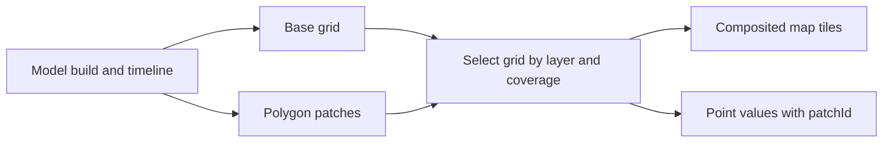

# Reading the forecast

Each build packages one model run's map tiles, point samples, and metadata. Tiles
and point queries evaluate the same grids and interpolation rules.

## Layers and missing values

- `usable-lift-msl`: estimated usable thermal top in metres above model mean sea
  level.
- `usable-lift-agl`: usable depth in metres above ground. The descriptor names
  `model-AGL` for model terrain or `terrain-AGL` for prepared DEM terrain.
- `precip-rate`: mean precipitation rate over the frame's trailing interval in
  millimetres per hour.

GFS publishes all three layers; ICON-EU publishes the two lift layers. Clients
read available layers from each build's manifest descriptors.

Every sample carries a status:

- `valid`: finite numeric value.
- `no-usable-lift`: daytime column solved to no usable lift, or the cell is in
  darkness across the frame's interval and valid time
  (`solarElevation <= minimumSolarElevationDeg`, support `0`). Public MSL value
  is `null`; AGL value is `0`.
- `unavailable`: required inputs are missing or invalid, or—for `precip-rate`—the
  cell is in darkness (`solarElevation <= minimumSolarElevationDeg`). Value is
  `null`.
- `outside-domain`: coordinate falls outside the product's coverage mask. Value
  is `null`.

Each layer tracks its own input masks independently, so missing thermal inputs
leave `precip-rate` valid and vice versa. Sample responses also report
`interpolated` and bitmask `support` flags from the contributing grid cells.

## Coverage and resolution

- `soaring-land-v1` (GFS): land and a 50 km coastal buffer between 55°S and
  65°N on the 0.25° global grid (native tile zoom 7), excluding Russia,
  Antarctica, and Greenland.
- `icon-eu-land-v1` (ICON-EU): land and a 50 km coastal buffer across the
  0.0625° European domain (23.5°W–62.5°E, 29.5°N–70.5°N, native tile zoom 8),
  with the same country exclusions.

Coverage masks intersect cell footprints with Natural Earth land polygons and
include a 1-cell halo for boundary interpolation. Source metadata and digests
live in [`packages/contracts/coverage/source.json`](../packages/contracts/coverage/source.json)
and [`packages/contracts/coverage/icon-eu-land-v1/source.json`](../packages/contracts/coverage/icon-eu-land-v1/source.json).
Version-3 manifests pin the grid, bounds, coverage descriptor, and bitset
digests so retained builds remain self-contained.

Version-4 builds add internal patches with their own grids and methods under the
same model and frame times. Polygon and output-mask membership select a patch
per layer before values are read. Selected no-lift and unavailable values remain
in effect; sampling never falls back to the coarse grid. Halo cells support
interpolation at the mask edges. Missing advertised patch assets fail the request.

A point value's `patchId` selects its grid, method and ground-reference
descriptors. One request can combine base MSL or precipitation with refined AGL.

## Time and retention

- `cycle`: upstream model initialization time (UTC).
- `validTime`: forecast valid time (UTC).
- `intervalStart` / `intervalEnd`: trailing flux and precipitation window (UTC).
- `createdAt` / `ageSeconds`: build creation timestamp and elapsed seconds since
  the build started.

Both models configure hourly candidate frames from `+1h` through `+24h` using
hourly source fields and recovered interval fluxes. ICON-EU filters out frames
where no covered output cell is sunlit at the interval start, midpoint, or end,
while still fetching preceding-hour flux companions needed to de-average the
first sunlit hour. GFS publishes all 24 frames.

`expiresAt` sets the 7-day retention deadline. Clients display a notice once
`now` passes the last frame's `validTime` while keeping historical frames
viewable until `expiresAt`. See [operations](operations.md) for publication and
expiry rules.

## Colour and interpolation

[layers.ts](../packages/contracts/src/layers.ts) defines palette thresholds,
colours, and legend labels, which are snapshotted into each build manifest. On
lift tiles, `no-usable-lift` and nonpositive AGL values render transparent.

When all four surrounding grid cells are valid (or `no-usable-lift` on lift
layers), the sampler interpolates bilinearly; if any contributor is missing, it
returns the nearest cell's value and status. See
[science and sampling](science.md) for exact rules.
