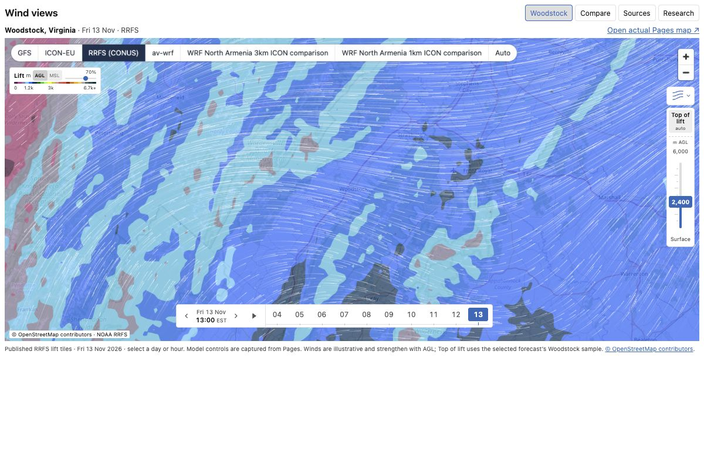
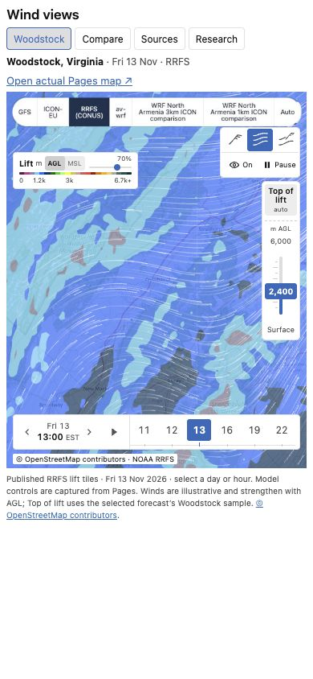

# Wind overlay build target

Build the approved Woodstock controls and three wind views in the standalone map.
The [data plan](weather-data-plan.md) owns delivery and implementation sequencing.

Approved 2026-11-13. These captures use published RRFS lift for Woodstock,
Virginia, with illustrative winds that strengthen with height. Production winds
follow the forecast, including shear and decreases with height.

## Wind display

Support **White trails** (default), **XC barbs**, and **Flow + sparse barbs**.
Use thin, connected white trails. Keep speed coloring off. All three views sample
one wind field; switching the style reuses resident data. The hybrid reduces barb
density while retaining the same glyphs and speed values.

Place the wind menu directly above the height rail. Its closed button is
48 × 32 CSS px, with the selected style glyph and a chevron. The open menu is
about 100 × 62 px and expands up and left. Its first row selects the three styles;
its second row contains wind visibility and animation pause/play.

Selecting a style enables wind and closes the menu. Hiding wind retains its style
and height. Pause is disabled for barbs and hidden wind. Show the paused/off state
on the closed control. Escape and outside click close the menu; restore keyboard
focus to its trigger. Keep these controls together beside the rail.

## Wind height

Keep the rail **48 CSS px wide**, about **198 px tall on phone / 238 px on desktop**,
including its top selector. Reserve map space below it for the timeline.

- The bottom stop is **Surface**: source 10 m wind above model terrain.
- Numeric stops are **600 through 6000 m AGL**, in 600 m steps, relative to the
  prepared local terrain. Display the selected value beside the thumb.
- **Top of lift** is a separate button above 6000, divided from the numeric rail
  and marked `auto`. It follows the local usable-lift ceiling across the map.
- Selecting Top of lift hides the fixed-height thumb and retains the last fixed
  selection. Moving the rail returns to fixed-height mode.

Keep `m AGL` inside the rail. The phone has no duplicate upper-left wind label.
Unsupported height samples remain unavailable; Surface and valid calm remain
distinct. Top of lift may lie anywhere within the supported profile.

## Lift shading

Retain a separate **156 × 46 px** upper-left lift key. Put the AGL/MSL radio toggle
inside its existing `Lift m` line. Put the short opacity slider on that same line;
keep it visible and adjustable in 5% steps. Preserve the lift palette and labels.

Changing the lift reference changes shading and its key. Wind heights remain AGL.
Opacity affects only lift shading. The key and its controls share one compact box.

## Timeline

Use the captured compact strip: maximum **540 px wide**, **40 px tall on desktop /
44 px on phone**, with a date/time block, playback button, and scrollable hours.

- Place previous/next-day arrows beside the date. Keep the nearest available
  hour when changing days; disable arrows at the first/last available day.
- Use a quiet common baseline and short `00`–`23` hour labels. Show the selected
  date, full time, and timezone in the date block.
- Show published frame times, including sparse three-hour intervals. Scroll in
  whole hour cells and keep the selected cell fully visible.
- Playback advances through available frames across midnight and stops at the
  last frame. Replay begins at the first frame.
- Preserve the current requested/displayed-time distinction while data loads.
  Replace a field atomically and clear old wind trails when its time changes.

The capture uses `America/New_York` and UTC frame identities. Production uses the
application's explicit display timezone, including daylight-saving transitions.

## XC barb fidelity

The [XC guide](https://docs.xcskies.com/home/documentation/understanding-wind-barbs)
and observed [live map](https://www.xcskies.com/map) are the visual references.
Match the artwork with independent assets and the following measured targets:

- A world/tile-anchored **32 CSS px lattice**: eight centers per 256 px tile,
  starting at 16 px. Keep pan/zoom anchoring stable.
- Approximately 24 px glyph extent and 21 px full staff; 1 CSS px black stroke,
  butt caps, miter joins, and no outline halo. Rotate the staff with wind direction.
- Upright integer speed labels in Helvetica Neue/Arial, about 9.6 px. Apply the
  selected unit conversion before truncating the displayed value.
- Calm is the literal capital **O**, about 10 px Arial, when the displayed
  truncated speed is zero. A valid exact `(0, 0)` vector also renders calm.
- Missing wind draws no calm symbol. Feather thresholds and label offsets must
  match XC golden captures in each supported unit and direction.

Place the unfeathered tip at the sampled location; it points downwind, in the
direction particles travel. The feathers extend upstream.
Browser font rasterization may differ, so compare geometry and CSS-pixel sizes
separately from antialiasing.

## Acceptance

Verify the controls at 320 px and 390 px phone widths and a 1200 px desktop view.
Keep the rail clear of the timeline, labels unclipped, and the page free of
horizontal overflow. The captured Pages model strip is contextual reference;
production retains its real model navigation.

Use one Tab stop per radio group, arrow/Home/End navigation, accessible names,
visible selection, and a labelled native range. Test day boundaries, unavailable
hours, Top of lift without lift, style changes while paused, wind off/on, and
rapid height/time changes. Compare barbs at calm and feather thresholds; verify
white trails and the hybrid against the same decoded vectors.

Capture provenance: RRFS cycle `2026-11-12T18:00:00Z`, build
`20261112T215710Z-fefa6305-83de-488b-a745-700ec7eda922`, displayed forecast
`2026-11-13T18:00:00Z`. Map imagery credits remain visible in both captures.
